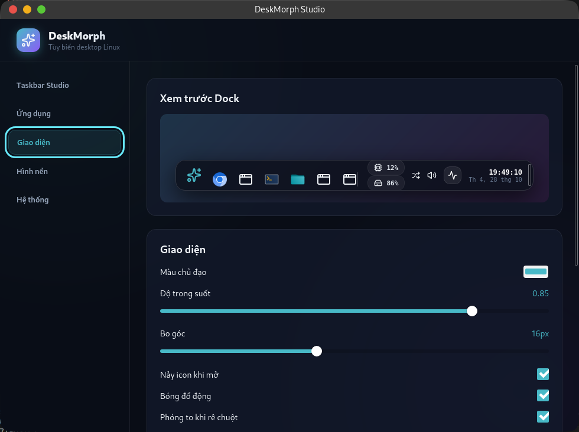

# DeskMorph

Dock tùy biến cho Linux, xây bằng React 19, TypeScript và Tauri 2/Rust. Mục tiêu là luồng tìm ứng dụng → mở → ghim → sắp xếp → quản lý cửa sổ, cùng Studio, hình nền và tiện ích hệ thống.

Đang phát triển, chưa có bản phát hành đã qua cài sạch/nâng cấp. Xem [kế hoạch 99 đầu việc](docs/IMPLEMENTATION_PLAN.md) và [kết quả kiểm thử thực tế](docs/PROGRESS.md) để phân biệt implementation với phạm vi đã xác minh.



Ảnh chụp Studio thật trên môi trường tham chiếu, không phải mockup.

## Môi trường hỗ trợ

| Môi trường/chức năng | Trạng thái |
| --- | --- |
| Pop!_OS 24.04, GNOME 46, X11, x86_64 | Môi trường kiểm thử tham chiếu; chưa qua toàn bộ cổng phát hành |
| Quản lý cửa sổ X11 | Adapter X11; cần `xprop` và DISPLAY hợp lệ |
| GNOME wallpaper | GSettings; gallery/shuffle/scheduler đã có native tests |
| Audio | `pactl` JSON + PulseAudio hoặc PipeWire PulseAudio; native test bằng null sink |
| Media | MPRIS trên session bus; hai fixture players đã qua test; ảnh bìa chỉ nhận file cục bộ |
| Pin/mạng | UPower display aggregate và NetworkManager; có trạng thái thiếu service |
| Downloads | XDG user directories; adapter COSMIC Files đã kiểm thử trên máy tham chiếu |
| Phím tắt launcher X11 | Tùy chỉnh, mặc định tắt; phát hiện xung đột, thử lại và tắt trong Hệ thống |
| Thùng rác | Chỉ bật khi desktop có URI handler; chưa khả dụng trên máy tham chiếu |
| Wayland native / KDE / COSMIC session | Chưa được xác minh; không công bố hỗ trợ window management native |

Có COSMIC Files được cài không đồng nghĩa phiên desktop là COSMIC. Máy tham chiếu hiện chạy GNOME/X11. Mixed DPI, hotplug, sleep/resume thực tế và global shortcuts portal trên Wayland còn trong kế hoạch.

Xem [ma trận capability và cách phát hiện](docs/CAPABILITIES.md) cho liệt kê/chuyển/đóng cửa sổ, các trường hợp thiếu hỗ trợ và giới hạn Wayland.

## Dùng trong chế độ phát triển

Cần Node.js 22.12 trở lên, npm, Rust stable/Cargo và các thư viện native. Trên Ubuntu/Pop!_OS 24.04:

```sh
sudo apt install build-essential pkg-config libssl-dev libgtk-3-dev libwebkit2gtk-4.1-dev libayatana-appindicator3-dev librsvg2-dev libx11-dev libxi-dev libxcb1-dev patchelf x11-utils pulseaudio-utils
npm ci
npm run tauri -- dev
```

Lần đầu Cargo cần tải dependencies. Cổng Vite mặc định là 1420. Nếu một instance cùng profile đang chạy, lần mở tiếp theo chuyển tới instance đó và mở Studio; không tạo Dock thứ hai.

Đóng Studio giữ Dock khi bật “Giữ Dock khi đóng Studio”. Chạy executable một lần nữa để mở lại Studio; dùng “Thoát DeskMorph” trong Hệ thống để thoát hẳn. Tự ẩn, chọn màn hình và các widget được điều chỉnh ở Taskbar Studio.

Trong Hệ thống, bạn có thể bật phím tắt launcher như `Ctrl+Super+K`. Cú pháp dùng Ctrl/Alt/Shift/Super và chữ ASCII, số, F1–F12 hoặc Space; không nhận phím trần hay chỉ Shift. `Ctrl+Alt+F1–F12` bị từ chối vì có thể chuyển virtual console. Khi có xung đột, phím đã chọn được lưu nhưng báo chưa hoạt động; đổi phím hoặc thử lại sau khi giải phóng tổ hợp. Tắt Dock tạm ngừng đăng ký; mở lại Dock khôi phục lựa chọn. Wayland hiện chưa hỗ trợ.

## Build và cài thủ công

```sh
npm run tauri -- build --no-bundle
install -Dm755 src-tauri/target/release/deskmorph "$HOME/.local/bin/deskmorph"
"$HOME/.local/bin/deskmorph"
```

Đây là cách cài từ source, chưa phải gói phát hành đã xác minh. Sau khi đặt executable ở vị trí cố định, dùng “Đăng ký vào menu ứng dụng” và tùy chọn autostart trong Hệ thống. Đăng ký từ thư mục build tạm sẽ khiến desktop entry trỏ vào executable tạm đó.

Để nâng cấp thủ công, xuất JSON dự phòng, thoát DeskMorph rồi thay executable tại cùng vị trí. Cấu hình nằm ngoài thư mục executable. Luồng nâng cấp/cài sạch vẫn cần kiểm thử phát hành.

Để gỡ, tắt autostart và thoát app; xóa executable đã cài cùng các desktop entry do app tạo:

```sh
rm -f "$HOME/.local/bin/deskmorph"
rm -f "${XDG_CONFIG_HOME:-$HOME/.config}/autostart/deskmorph.desktop"
rm -f "${XDG_DATA_HOME:-$HOME/.local/share}/applications/deskmorph.desktop"
```

Các lệnh này giữ cấu hình và cache để có thể khôi phục. Không tự xóa hình nền hay dữ liệu Thùng rác.

## Cấu hình và dữ liệu

- Cấu hình: `${XDG_CONFIG_HOME:-~/.config}/com.ducthanhdev.deskmorph/config.json`, có `schemaVersion` và `revision`.
- Cập nhật qua native store: validate → file tạm/sync/rename → phát snapshot tới các cửa sổ. File hỏng được giữ trong `.recovery.json`; localStorage cũ chỉ dùng di trú.
- Export/import JSON và reset có bước xem thay đổi/hoàn tác; import cũ bị từ chối nếu cấu hình đã thay đổi sau khi review.
- `DESKMORPH_CONFIG_HOME` là override tuyệt đối riêng cho profile/config/instance/autostart của DeskMorph. Khi test GSettings, giữ nguyên `XDG_CONFIG_HOME` của desktop để dconf đọc và ghi cùng namespace.
- Gallery giới hạn 20.000 mục/5.000 ảnh mỗi scan, không theo symlink thư mục; render 24 ảnh/trang. Lịch chạy ở backend khi Studio đóng; sleep/clock jump mới được test mô phỏng.
- Chọn đầu ra audio chỉ đổi default cho luồng mới. Không chuyển stream đang phát; slider không tự tăng/giảm mức âm lượng hệ thống trước khi bạn điều chỉnh.

## Kiểm thử

```sh
npm test
npm run build
cargo check --locked --manifest-path src-tauri/Cargo.toml
cargo test --locked --manifest-path src-tauri/Cargo.toml --lib -- --include-ignored
```

Workflow CI được cấu hình để chạy các kiểm tra này (Rust tests dùng Xvfb với `xvfb`/`xauth`) trên Ubuntu 24.04; chưa chạy trên GitHub trong phiên này và không thay thế kiểm thử desktop. Trong sandbox cấm Unix socket, chạy Rust tests không có `--include-ignored` và ghi rõ test bị bỏ qua.

Native UI tests là opt-in, chỉ thao tác profile tạm có nhận diện PID riêng. Chúng cần phiên X11 đang **mở khóa**, AT-SPI/Python GI/GTK3/libXtst và binary với frontend được nhúng. Script chặn phím khi focus không thuộc PID test. Các ca audio dùng null sink, MPRIS dùng fixtures, wallpaper khôi phục trạng thái cũ trong `finally`.

```sh
npm run build
cargo build --offline --manifest-path src-tauri/Cargo.toml --target-dir src-tauri/target/agent --features custom-protocol
/usr/bin/python3 tests/desktop_smoke.py --restart --basic --studio-smoke --config-smoke --launcher-smoke
/usr/bin/python3 tests/desktop_smoke.py --autohide-smoke --popup-smoke
/usr/bin/python3 tests/desktop_smoke.py --shortcut-smoke
/usr/bin/python3 tests/desktop_smoke.py --window-list-smoke
/usr/bin/python3 tests/desktop_smoke.py --lifecycle-smoke
/usr/bin/python3 tests/desktop_smoke.py --registration-smoke
/usr/bin/python3 tests/desktop_smoke.py --audio-smoke --media-smoke --audio-exit
/usr/bin/python3 tests/desktop_smoke.py --force-close-smoke --wallpaper-smoke
/usr/bin/python3 tests/desktop_smoke.py --system-smoke --system-open-smoke
```

Các ca `--system-open-smoke` hiện dành cho COSMIC Files trên máy tham chiếu. Xem PROGRESS.md để biết các ca service lỗi, scheduler và thư viện lớn. Báo cáo nằm trong `/tmp/deskmorph-desktop-test`; không suy diễn một lần pass thành hỗ trợ mọi desktop.

Stress popup tự restart profile test và dùng Hidden overrides trong XDG_DATA_HOME tạm để launcher chỉ mở fixture; vẫn giữ thư mục MIME/icon/schema của hệ thống. Auto-hide có ca riêng ở top/bottom; các ca tương tác khác đặt baseline Dock hiện đầy đủ. Outside-click được kiểm tra nằm ngoài popup trước khi gửi click vật lý.

## Xử lý lỗi thường gặp

- Không thấy Dock: mở lại Studio; kiểm tra “Bật Dock”, màn hình đã chọn và session X11/xprop. Wayland native hiện chưa có adapter quản lý cửa sổ.
- WebKit render trống trên máy có lỗi DMA-BUF: thử chạy với `WEBKIT_DISABLE_DMABUF_RENDERER=1`; desktop entry do app đăng ký đã thêm biến này.
- Audio không khả dụng: kiểm tra `pactl info` và PulseAudio/PipeWire PulseAudio của phiên người dùng. App vẫn dùng được khi service thiếu.
- Hình nền không đổi: adapter hiện chỉ cho GNOME, kiểm tra schema/writable settings; lỗi được hiển thị trong gallery/lịch.
- Test bị chặn focus hoặc active XID là `0x0`: kiểm tra desktop có khóa màn hình hay không; không bỏ qua PID guard.
- Mở app lần nữa chỉ hiện Studio: đó là hành vi single-instance. Dùng profile riêng nếu cần chạy instance kiểm thử.
- Lỗi instance không xác nhận mở Studio: instance development cũ có thể chưa hỗ trợ ACK của giao thức mới. Thoát instance đó bình thường rồi mở lại; không xóa lock/socket khi tiến trình còn chạy. Các lỗi startup trả exit code 1 và thông điệp trên stderr.

Kiến trúc hiện tại và các giới hạn: [ARCHITECTURE.md](docs/ARCHITECTURE.md). Bảng so sánh hệ điều hành cũ chỉ là tài liệu tham khảo, không phải bằng chứng hoàn thành tính năng.
