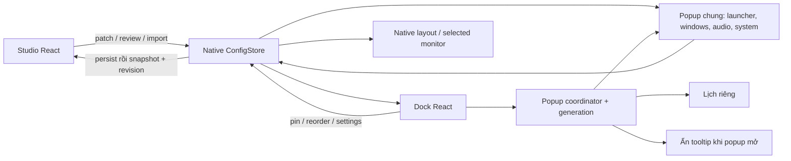
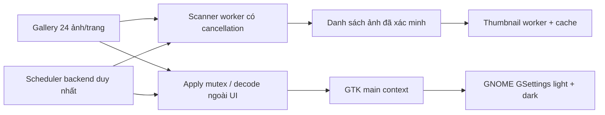

# Kiến trúc DeskMorph hiện tại

Trạng thái: development 0.1.0. Tài liệu mô tả code đang có; phạm vi đã kiểm thử và các mục chưa hoàn tất nằm trong [PROGRESS.md](PROGRESS.md) và [IMPLEMENTATION_PLAN.md](IMPLEMENTATION_PLAN.md).

## Cửa sổ và luồng dữ liệu

Tauri tạo trước các window: `main`, `taskbar`, `dock-context-menu`, `calendar-flyout`, `dock-tooltip`. `App.tsx` chọn frontend theo query `window`. Popup chung đổi mode và remount theo generation; visibility dành cho Audio/Media/System mang cùng generation để bỏ qua sự kiện ẩn trễ của lượt cũ; chỉ có một popup tương tác active. Calendar vẫn là native window riêng. Tooltip không lấy focus; input shape rỗng được đặt trong GTK map sau khi GDK window tồn tại, tránh unwrap trong Tao khi tooltip chưa map.

`popup.rs` tính hình học từ Dock, scale, monitor origin và work area. Generation ngăn watcher click ngoài hoặc callback focus cũ đóng popup mới. Focus loss được kiểm tra lại sau 120 ms. Outside-click watcher X11 chỉ tồn tại trong vòng đời generation hiện hành; dùng XInput2 raw button queue qua libXi để không bỏ sót click ngắn giữa hai lượt poll 40 ms, fallback pointer state khi thiếu XI2. Focus WebKit được yêu cầu sau lượt GTK map và kiểm tra generation; Escape có handler tại GTK toplevel để đóng được khi DOM key listener không nhận phím sau hide/show nhanh. Auto-hide giữ Dock hiện khi có popup active. Khi bật auto-hide trong X11, Dock đối chiếu con trỏ global với native rect mỗi 250 ms (IPC, không spawn process), chờ ngoài 500 ms rồi ẩn; dừng đối chiếu khi popup mở hoặc Dock tắt. Cơ chế này xử lý hover DOM bị thiếu/sai sau resize vùng kích hoạt cạnh màn hình; cần tính vào baseline hiệu năng còn pending.

## Cấu hình bền vững

`src/config/defaults.json` là nguồn mặc định chung cho TypeScript và Rust. `ConfigStore` giữ schema version, revision và snapshot; managed mutex serialize patch/import/pin. Native store validate trước ghi. File tạm được sync, rename và sync thư mục; file mới/recovery dùng quyền 0600. Nếu IO trước commit thất bại, snapshot trong bộ nhớ không đổi. Nếu rename đã thành công nhưng sync thư mục lỗi, cấu hình mới được giữ nhất quán với file và phát cảnh báo độ bền; không trả lỗi ghi khiến bộ nhớ giữ revision cũ. Có test fault injection cho trường hợp sau rename.

Load/migration cho phép fallback trường sai và giữ bản gốc trong recovery; patch/import là strict. Cấu hình phiên bản tương lai không bị ghi đè. localStorage chỉ cung cấp dữ liệu di trú khi chưa có cấu hình native. Import/reset review mang revision; commit từ chối review đã cũ. Thay đổi native window thất bại không được coi là lưu cấu hình thành công hoàn toàn; lỗi được trả về UI.

Frontend `config/store.ts` dùng external store chung trong từng WebView, nghe native snapshot trước khi lấy snapshot đầu, nhận revision không giảm, và dọn đăng ký listener đến muộn. Không có ghi cấu hình qua event vòng lặp. Autostart và menu entry dùng executable thực tế với desktop-entry escaping; single-instance dùng flock + Unix socket theo config root.

Request mở Studio trên socket có deadline/giới hạn kích thước và đọc đến EOF để xử lý phân mảnh. Instance mới chỉ thoát thành công sau ACK của dispatch GTK; callback lỗi hoặc server không xác nhận trả lỗi startup/exit 1. Worker được stop/join trong Exit event trước khi runtime bị dọn. Request cũ chưa hỗ trợ ACK cần restart instance khi nâng development build; không tạo instance thứ hai để né lỗi forwarding.

## Adapter desktop

- `platform.rs`: session/desktop/capabilities và monitor topology. Probe EWMH tách enumerate/activate/close; yêu cầu property đúng kiểu và atom chính xác, command action kiểm tra lại hỗ trợ. Không suy diễn DISPLAY/tool existence hay XWayland là hỗ trợ cửa sổ Wayland native. Ma trận ban đầu ở [CAPABILITIES.md](CAPABILITIES.md).
- `window_manager/`: interface list/activate/close/force-kill; adapter X11 dùng xprop và X11 client messages. Đóng bình thường không tự force-kill. Force-close có xác nhận mất dữ liệu trên UI, chỉ nhận XID còn trong _NET_CLIENT_LIST, loại cửa sổ nội bộ/panel và dùng xkill trong child process để chứa lỗi XID stale. Không gửi SIGKILL theo _NET_WM_PID do client tự khai. Có thể đóng tất cả cửa sổ cùng X client; native regression force-close với PID giả và stress popup đã qua trên GNOME/X11 tham chiếu; các giới hạn còn lại trong PROGRESS.md.
- `applications.rs`: GIO DesktopAppInfo xử lý XDG precedence/locale/visibility/Exec/actions; GTK IconTheme resolve icon. Catalogue có cache; giữ AppInfoMonitor và GTK theme subscription trên GTK thread, đánh dấu dirty/phát event khi entry hoặc theme thay đổi và disconnect khi thoát. Tìm kiếm tiếng Việt/xếp hạng ở `appSearch.ts`; grouping ở `windowGroups.ts`.
- `layout.rs`, `geometry.rs`, `dockAppearance.ts`: native placement/auto-hide và tokens/metrics dùng chung cho Dock/Studio preview. Monitor hotplug/mixed DPI thực tế còn chưa kiểm thử đầy đủ.

Topology polling dùng GTK timeout 2 giây được remove lúc Exit, tránh worker chờ dispatch GTK khi main thread đang shutdown. Calendar lấy snapshot visibility sau subscribe event và không ghi đè event mới bằng query cũ; `useClock` dừng khi popup ẩn hoặc widget/Dock tắt. Desktop đã mở khóa và hồi quy tương tác tiếp tục; kết quả cùng các giới hạn trong PROGRESS.md.

## Wallpaper

Scanner giới hạn 20.000 mục và 5.000 ảnh, canonical-path dedup, không theo directory symlink, báo lỗi từng mục có giới hạn. Thumbnail chỉ nhận path trong thư viện đã scan, decode 320×200, invalidation theo path/mtime/size; cache tối đa 512 file/64 MB. File ảnh tối đa 128 MB/100 MP.

Scheduler dùng deadline wall clock và config epoch. Sau một khoảng quá hạn chỉ thử một lần, không đổi bù nhiều ảnh; config thay đổi/disable vô hiệu lượt cũ trước khi ghi. Worker không giữ config lock trong khi chờ GTK main context. GSettings objects được giữ trên GTK main loop để tránh cache đọc cũ. Scheduler dừng khi app thoát. Sleep/resume mới được test bằng clock giả; một phút native đã được test khi Studio đóng.

## Audio và media

`audio.rs` dùng argv `pactl`, không qua shell. Snapshot đọc raw channel value để không phụ thuộc locale của volume_percent. Command có giới hạn thời gian/output, serialize ghi, giữ sink name cụ thể và từ chối sink đã biến mất. Slider ghi 0–100%; không tự clamp amplification hiện có. Chọn default không di chuyển stream đang phát.

Một `pactl subscribe` tồn tại khi popup audio mở, debounce sink/server events, reconnect có backoff; child được kill/wait khi ẩn và join worker khi thoát. Frontend giữ focus slider và gộp giá trị mới trong khi request chạy.

`media.rs` dùng session D-Bus MPRIS. Discover tối đa 16 player và ngân sách thời gian; player lỗi không làm mất các player khác. Ưu tiên Playing rồi tên ổn định, cho chọn player. Lệnh chỉ nhắm unique owner đã review, kiểm tra capability và owner trước khi gửi; không chuyển lệnh sang player vừa thay thế. PropertiesChanged và NameOwnerChanged cập nhật UI khi popup hiện. Player/service lỗi có trạng thái trên UI; session bus restart thực tế còn cần test.

Artwork chỉ nhận file URI cục bộ, giới hạn 8 MB/16 MP, resize 160 px và encode PNG. Cache bộ nhớ tối đa 16 ảnh, mỗi ảnh tối đa 256 KB, invalidation theo path/mtime/size. Remote artwork hiện có fallback, không tải mạng.

## Tiện ích hệ thống

`system_widgets.rs` đọc UPower display device (aggregate) và NetworkManager qua system bus, timeout từng call, cache chung 5 giây cho Dock/popup. Không tự tạo time estimate khi UPower trả 0. Network state và connectivity probe được trình bày riêng. `get_system_stats` có sampler/cache chung 2 giây, tránh refresh CPU cạnh tranh giữa Dock/preview/popup; RAM hiển thị GiB.

System monitor chỉ chọn desktop ID đã nhận diện và tắt nút khi thiếu app. Downloads theo XDG user directories, từ chối thư mục không tồn tại, chọn app category FileManager thay vì giả định mọi default inode/directory đều là file manager. COSMIC Files dùng argv native path đã kiểm thử. Trash chỉ bật khi có URI handler; máy tham chiếu hiện unsupported. Global shortcuts chưa được triển khai.

## Quyền và nội dung WebView

UI chỉ cần native event listen/unlisten; các hành động desktop đi qua commands của DeskMorph. Plugin opener và quyền opener không còn dùng. CSP production chặn script inline/eval và kết nối mạng tùy ý; style inline vẫn cần cho tokens/geometry. Font dùng hệ thống, không tải Google Fonts. Asset scope ban đầu rỗng; native chỉ cho phép từng icon đã resolve và thumbnail đã tạo. Artwork là PNG data URL đã giới hạn.

Native regression icon trong ảnh Studio, thumbnail kiểm tra pixel, IPC và force-close đã qua để chốt G9.6 trong môi trường tham chiếu; đây không phải chứng nhận an toàn trên mọi desktop. Custom app commands chưa có phân quyền riêng theo từng window; các WebView hiện đều là nội dung local do app cung cấp. Không nhúng trang web bên ngoài.

## Kiểm thử và phát hành

`hooks/polling.ts` quản lý một timer cho mỗi vòng polling; effect mới chờ native request cũ vì hủy consumer không hủy được IPC đã gửi. Ẩn window dừng timer, hiện lại refresh; cleanup hủy signal và listener. Backend vẫn chia sẻ các mẫu CPU/RAM/system status giữa WebView.

Node tests kiểm tra search/grouping/appearance/i18n và polling lifecycle. Rust tests kiểm tra config, parser, geometry, Unix socket, scheduler/scanner/cache, audio mapping và UPower/NetworkManager mapping. Fixture ứng dụng dùng subprocess để cô lập cache môi trường GLib; launch DBusActivatable dùng bus riêng, monitor test tạo/xóa desktop entry trong thư mục tạm. Native AT-SPI tests là opt-in trên profile tạm. Chúng không thay thế thử mixed DPI, sleep/resume, service restart, compositor khác hoặc cài sạch.

Workflow GitHub được thêm để chạy unit/build trên Ubuntu 24.04; chưa có bằng chứng workflow đã chạy trên GitHub trong phiên này. Chưa tạo release artifact được cài sạch/nâng cấp. Tài liệu so sánh hệ điều hành cũ là tham khảo, không phải trạng thái implementation authoritative.
