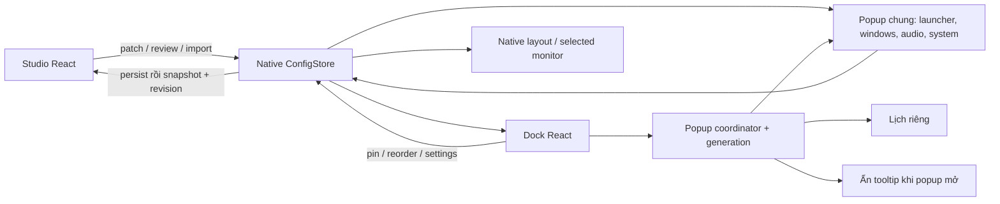
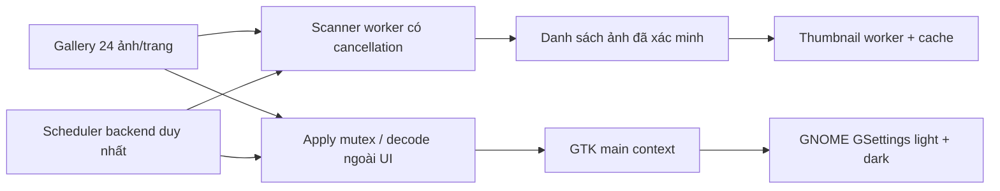

# Kiến trúc DeskMorph hiện tại

Trạng thái: development 0.1.0. Tài liệu mô tả code đang có; phạm vi đã kiểm thử và các mục chưa hoàn tất nằm trong [PROGRESS.md](PROGRESS.md) và [IMPLEMENTATION_PLAN.md](IMPLEMENTATION_PLAN.md).

## Cửa sổ và luồng dữ liệu

Tauri tạo trước các window: `main`, `taskbar`, `dock-context-menu`, `calendar-flyout`, `dock-tooltip`. `App.tsx` chọn frontend theo query `window`. Popup chung đổi mode và remount theo generation; visibility dành cho Audio/Media/System mang cùng generation để bỏ qua sự kiện ẩn trễ của lượt cũ; chỉ có một popup tương tác active. Calendar vẫn là native window riêng. Tooltip không lấy focus; input shape rỗng được đặt trong GTK map sau khi GDK window tồn tại, tránh unwrap trong Tao khi tooltip chưa map.

`popup.rs` tính hình học từ Dock, scale, monitor origin và work area. Generation ngăn watcher click ngoài hoặc callback focus cũ đóng popup mới. Focus loss được kiểm tra lại sau 120 ms. Outside-click watcher X11 chỉ tồn tại trong vòng đời generation hiện hành; dùng XInput2 raw button queue qua libXi để không bỏ sót click ngắn giữa hai lượt poll 40 ms, fallback pointer state khi thiếu XI2. Focus WebKit được yêu cầu sau lượt GTK map và kiểm tra generation; Escape có handler tại GTK toplevel để đóng được khi DOM key listener không nhận phím sau hide/show nhanh. Auto-hide giữ Dock hiện khi có popup active. Khi bật auto-hide trong X11, Dock đối chiếu con trỏ global với native rect mỗi 250 ms (IPC, không spawn process), chờ ngoài 500 ms rồi ẩn; dừng đối chiếu khi popup mở hoặc Dock tắt. Cơ chế này xử lý hover DOM bị thiếu/sai sau resize vùng kích hoạt cạnh màn hình; đã đo riêng trong ma trận hiệu năng G9.7 (PERFORMANCE.md).

Danh sách cửa sổ và phần cửa sổ trong menu chuột phải dùng `useLiveWindows`: cùng cơ chế polling 1,5 giây không chồng request, gom lại theo các pin đang bật và WM_CLASS đầy đủ không phân biệt hoa thường; popup của pin truyền appId để theo dõi mapping hiện hành, nhóm chưa ghim giữ lớp lúc mở nhưng loại cửa sổ đã chuyển sang pin. Cập nhật title/active/thêm/bớt. `usePopupActive` subscribe sự kiện generation trước rồi truy vấn coordinator để xử lý trường hợp popup đã ẩn trong lúc đăng ký listener; dừng poll khi popup ẩn. Kết quả cũ bị bỏ khi effect dừng. Lệnh hide từ hai component truyền generation để callback cũ không đóng popup mới. Hide không truyền generation vẫn dành cho thao tác đóng popup hiện tại như Escape hoặc tắt Dock.

WindowList giữ lựa chọn theo XID khi đổi tiêu đề. Nếu hàng biến mất, chọn hàng kế bên theo vị trí trước đó (hoặc hàng cuối còn lại), chỉ yêu cầu DOM focus khi popup active và document có focus; nghe thêm window focus cho trường hợp GTK map hoàn tất sau React effect. Home/End/mũi tên đổi lựa chọn; Enter dùng button activation, Escape do coordinator xử lý. Hàng không bị xóa lạc quan sau yêu cầu close: ứng dụng có thể đang chờ xác nhận. Danh sách rỗng tự đóng theo generation; menu chuột phải vẫn giữ các thao tác của app và loại target force-close đã biến mất.

## Sắp xếp Dock và tooltip

Pin dùng Pointer Events với pointer capture: ngưỡng kéo 8 CSS px, chỉ nhận pointer chính/nút trái, xác định pin đích trong document. Kéo giữ nguyên thứ tự cho tới pointer-up; thả hợp lệ gọi một mutation, thả ngoài/Escape/blur/pointer-cancel/lost capture hủy. Click sau kéo bị chặn để không mở app; magnification tạm dừng và đích thả có viền. Không dùng HTML drag-and-drop cho sắp xếp pin. Ctrl+Shift+Left/Right và menu Sang trái/Sang phải dùng cùng native mutation; không ghi khi vị trí không đổi, giữ focus pin sau lưu thành công. Pin có aria-keyshortcuts.

Chiều rộng nội dung có thể được cập nhật trong khi popup đang bám Dock. Backend hoãn resize tới lúc popup đóng; hide nhả coordinator lock rồi áp dụng layout mới nhất để không deadlock và không để icon mới bị widget che. Tooltip GTK đặt accept_focus=false và focus_on_map=false; focus=false lúc tạo window chưa đủ cho những lần show sau. Input shape rỗng tiếp tục được đặt khi map để tooltip không chặn click.

## Cấu hình bền vững

`src/config/defaults.json` là nguồn mặc định chung cho TypeScript và Rust. `ConfigStore` giữ schema version, revision và snapshot; managed mutex serialize patch/import/pin. Native store validate trước ghi. File tạm được sync, rename và sync thư mục; file mới/recovery dùng quyền 0600. Nếu IO trước commit thất bại, snapshot trong bộ nhớ không đổi. Nếu rename đã thành công nhưng sync thư mục lỗi, cấu hình mới được giữ nhất quán với file và phát cảnh báo độ bền; không trả lỗi ghi khiến bộ nhớ giữ revision cũ. Có test fault injection cho trường hợp sau rename.

Load/migration cho phép fallback trường sai và giữ bản gốc trong recovery; patch/import là strict. Cấu hình phiên bản tương lai không bị ghi đè. localStorage chỉ cung cấp dữ liệu di trú khi chưa có cấu hình native. Import/reset review mang revision; commit từ chối review đã cũ. Thay đổi native window thất bại không được coi là lưu cấu hình thành công hoàn toàn; lỗi được trả về UI.

Frontend `config/store.ts` dùng external store chung trong từng WebView, nghe native snapshot trước khi lấy snapshot đầu, nhận revision không giảm, và dọn đăng ký listener đến muộn. Không có ghi cấu hình qua event vòng lặp. Autostart và menu entry dùng executable thực tế với desktop-entry escaping; single-instance dùng flock + Unix socket theo config root.

Request mở Studio trên socket có deadline/giới hạn kích thước và đọc đến EOF để xử lý phân mảnh. Instance mới chỉ thoát thành công sau ACK của dispatch GTK; callback lỗi hoặc server không xác nhận trả lỗi startup/exit 1. Worker được stop/join trong Exit event trước khi runtime bị dọn. Request cũ chưa hỗ trợ ACK cần restart instance khi nâng development build; không tạo instance thứ hai để né lỗi forwarding.

## Adapter desktop

- `platform.rs`: session/desktop/capabilities và monitor topology. Probe EWMH tách enumerate/activate/close; yêu cầu property đúng kiểu và atom chính xác, command action kiểm tra lại hỗ trợ. Không suy diễn DISPLAY/tool existence hay XWayland là hỗ trợ cửa sổ Wayland native. Ma trận ban đầu ở [CAPABILITIES.md](CAPABILITIES.md).
- `window_manager/`: interface list/activate/close/force-kill; adapter X11 dùng xprop và X11 client messages. Đóng bình thường không tự force-kill. Force-close có xác nhận mất dữ liệu trên UI, chỉ nhận XID còn trong _NET_CLIENT_LIST, loại cửa sổ nội bộ/panel và dùng xkill trong child process để chứa lỗi XID stale. Không gửi SIGKILL theo _NET_WM_PID do client tự khai. Có thể đóng tất cả cửa sổ cùng X client; native regression force-close với PID giả và stress popup đã qua trên GNOME/X11 tham chiếu; các giới hạn còn lại trong PROGRESS.md.
- `applications.rs`: GIO DesktopAppInfo xử lý XDG precedence/locale/visibility/Exec/actions; GTK IconTheme resolve icon; application_icons.rs chuyển nguồn hợp lệ thành PNG 64 px trong cache giới hạn 512 file/32 KiB mỗi file. Catalogue có cache; giữ AppInfoMonitor và GTK theme subscription trên GTK thread, đánh dấu dirty/phát event khi entry hoặc theme thay đổi và disconnect khi thoát. Tìm kiếm tiếng Việt/xếp hạng ở `appSearch.ts`; grouping ở `windowGroups.ts`.
- `layout.rs`, `geometry.rs`, `dockAppearance.ts`: native placement/auto-hide và tokens/metrics dùng chung cho Dock/Studio preview. `dockVisuals.tsx` và `components/DockParts.tsx` dùng chung fallback/icon tile, indicator/count, launch shadow và CPU/RAM bars; `useReducedMotion` theo cả cấu hình lẫn media query hệ thống. Preview đọc catalogue/cửa sổ/số liệu thật theo polling có visibility/abort guard; chỉ là mẫu giao diện, không dispatch launch hoặc popup khi bấm icon. Nút thử hiệu ứng có timer được dọn khi unmount. Monitor hotplug/mixed DPI thực tế còn chưa kiểm thử đầy đủ.

Topology polling dùng GTK timeout 2 giây được remove lúc Exit, tránh worker chờ dispatch GTK khi main thread đang shutdown. Calendar lấy snapshot visibility sau subscribe event và không ghi đè event mới bằng query cũ; `useClock` dừng khi popup ẩn hoặc widget/Dock tắt. Desktop đã mở khóa và hồi quy tương tác tiếp tục; kết quả cùng các giới hạn trong PROGRESS.md.

## Wallpaper

Scanner giới hạn 20.000 mục và 5.000 ảnh, canonical-path dedup, không theo directory symlink, báo lỗi từng mục có giới hạn. Thumbnail chỉ nhận path trong thư viện đã scan, decode 320×200, invalidation theo path/mtime/size; cache tối đa 512 file/64 MB. File ảnh tối đa 128 MB/100 MP.

Scheduler dùng deadline wall clock và config epoch. Sau một khoảng quá hạn chỉ thử một lần, không đổi bù nhiều ảnh; config thay đổi/disable vô hiệu lượt cũ trước khi ghi. Worker không giữ config lock trong khi chờ GTK main context. GSettings objects được giữ trên GTK main loop để tránh cache đọc cũ. Scheduler dừng khi app thoát. Sleep/resume mới được test bằng clock giả; một phút native đã được test khi Studio đóng.

## Audio và media

`audio.rs` dùng argv `pactl`, không qua shell. Snapshot đọc raw channel value để không phụ thuộc locale của volume_percent. Command có giới hạn thời gian/output, serialize ghi, giữ sink name cụ thể và từ chối sink đã biến mất. Slider ghi 0–100%; không tự clamp amplification hiện có. Chọn default không di chuyển stream đang phát.

Một `pactl subscribe` tồn tại khi popup audio mở, debounce sink/server events, reconnect có backoff; child được kill/wait khi ẩn và join worker khi thoát. Frontend giữ focus slider và gộp giá trị mới trong khi request chạy.

`media.rs` dùng session D-Bus MPRIS. Discover tối đa 16 player và ngân sách thời gian; player lỗi không làm mất các player khác. Ưu tiên Playing rồi tên ổn định, cho chọn player. Lệnh và ảnh bìa chỉ nhắm unique owner cùng GUID session bus đã review; kiểm tra capability và cả hai định danh trước khi gửi, kể cả bus mới dùng lại unique owner cũ. PropertiesChanged và NameOwnerChanged cập nhật UI khi popup hiện. Player/service lỗi xóa controls cũ và hiện trạng thái lỗi. Kết nối media riêng chỉ được cache khi còn mở; khi bus đóng, worker bỏ subscriptions cũ và thử kết nối lại mỗi khoảng 2 giây khi popup hiện. Shared GIO connection của GTK tắt exit-on-close để bus mất không làm app thoát. Native test đã restart session dbus-daemon riêng hai lần, gồm outage hơn 4 giây; tự nhận player/signals mới, điều khiển replacement và dọn metadata match rule khi ẩn. Không khẳng định các thành phần GTK khác tự phục hồi mọi chức năng sau host session restart.

Artwork chỉ nhận file URI cục bộ, giới hạn 8 MB/16 MP, resize 160 px và encode PNG. Cache bộ nhớ tối đa 16 ảnh, mỗi ảnh tối đa 256 KB, invalidation theo path/mtime/size. Remote artwork hiện có fallback, không tải mạng.

## Tiện ích hệ thống

`system_widgets.rs` đọc UPower display device (aggregate) và NetworkManager qua system bus, timeout từng call, cache chung 5 giây cho Dock/popup. Không tự tạo time estimate khi UPower trả 0. Network state và connectivity probe được trình bày riêng. `get_system_stats` có sampler/cache chung 2 giây, tránh refresh CPU cạnh tranh giữa Dock/preview/popup; RAM hiển thị GiB.

System monitor chọn desktop ID đã nhận diện, thử entry kế tiếp khi GIO từ chối launch và tắt nút khi thiếu app. Downloads theo XDG user directories, từ chối thư mục không tồn tại, chọn app category FileManager thay vì giả định mọi default inode/directory đều là file manager. Truyền native GFile qua GIO để giữ quoted executable/wrappers/flags; COSMIC Files thật đã qua hồi quy với đường này. Trash chỉ bật khi có handler hỗ trợ URI và không Hidden (NoDisplay hợp lệ), dispatch tới chính handler đã kiểm; máy tham chiếu hiện unsupported. Xem [SYSTEM_TOOLS.md](SYSTEM_TOOLS.md).

## Phím tắt launcher

`shortcuts.rs` sở hữu một XCB connection riêng trên worker; không thay global Xlib error handler của GTK. Cấu hình `launcherShortcut` mặc định null, chỉ bật khi người dùng lưu. Checked passive grabs phát hiện xung đột, đăng ký mọi biến thể Caps/Num/Scroll Lock theo keymap thực tế và giải phóng cả đăng ký dở khi lỗi. Không dùng AnyModifier. MappingNotify đăng ký lại; mất connection báo lỗi và cho thử lại, chưa tự reconnect.

Trạng thái requested/registered/pending/error tách lựa chọn đã lưu khỏi đăng ký thực tế; generation bỏ kết quả và callback activation cũ. Tắt Dock giải phóng grabs; bật lại dùng lựa chọn đã lưu. Thoát app stop/join worker và đóng connection. Khi kích hoạt từ ứng dụng khác, timestamp X11 của phím được chuyển tới GTK `present_with_time`; callback focus cũng kiểm tra popup generation. Không nhận XSendEvent làm kích hoạt.

Cú pháp giới hạn Ctrl/Alt/Shift/Super cùng chữ ASCII, số, F1–F12 hoặc Space. Từ chối Ctrl+Alt+Fn vì checked grab không bảo đảm chặn cơ chế virtual console của Xorg. Keymap thiếu hoặc modifier mơ hồ báo lỗi; chưa xác minh mọi layout, remap thực tế, sleep/resume hoặc desktop X11 khác. Wayland portal chưa triển khai. Native GNOME/X11 đã qua xung đột/retry, focus từ GTK fixture riêng, đổi/tắt, pause theo Dock và exit/restart.

## Quyền và nội dung WebView

UI chỉ cần native event listen/unlisten; các hành động desktop đi qua commands của DeskMorph. Plugin opener và quyền opener không còn dùng. CSP production chặn script inline/eval và kết nối mạng tùy ý; style inline vẫn cần cho tokens/geometry. Font dùng hệ thống, không tải Google Fonts. Asset scope ban đầu rỗng; native chỉ cho phép thư mục application-icons-v1 không đệ quy chứa raster đã giới hạn, và từng thumbnail đã tạo; không cho WebView đọc source icon tùy ý. Artwork là PNG data URL đã giới hạn.

Native regression icon trong ảnh Studio, thumbnail kiểm tra pixel, IPC và force-close đã qua để chốt G9.6 trong môi trường tham chiếu; đây không phải chứng nhận an toàn trên mọi desktop. Custom app commands chưa có phân quyền riêng theo từng window; các WebView hiện đều là nội dung local do app cung cấp. Không nhúng trang web bên ngoài.

## Kiểm thử và phát hành

`hooks/polling.ts` quản lý một timer cho mỗi vòng polling; effect mới chờ native request cũ vì hủy consumer không hủy được IPC đã gửi. Ẩn window dừng timer, hiện lại refresh; cleanup hủy signal và listener. Backend chia sẻ các mẫu CPU/RAM/system status và snapshot cửa sổ tối đa 1 giây giữa WebView. WindowSnapshots serialize loader qua mutex, clone kết quả cho từng consumer, cache cả thành công rỗng nhưng xóa snapshot khi refresh lỗi. Activate/close/force-kill xác minh target qua adapter thật và invalidate sau thao tác; capability refresh invalidate trước broadcast. Số đo debug/release và ngân sách có trong PERFORMANCE.md.

Node tests kiểm tra search/grouping/appearance/i18n và polling lifecycle. Rust tests kiểm tra config, parser, geometry, Unix socket, scheduler/scanner/cache, audio mapping và UPower/NetworkManager mapping. Fixture ứng dụng dùng subprocess để cô lập cache môi trường GLib; launch DBusActivatable dùng bus riêng, monitor test tạo/xóa desktop entry trong thư mục tạm. Native AT-SPI tests là opt-in trên profile tạm. Chúng không thay thế thử mixed DPI, sleep/resume, service restart, compositor khác hoặc cài sạch.

Workflow GitHub được thêm để chạy unit/build trên Ubuntu 24.04; chưa có bằng chứng workflow đã chạy trên GitHub trong phiên này. Chưa tạo release artifact được cài sạch/nâng cấp. Tài liệu so sánh hệ điều hành cũ là tham khảo, không phải trạng thái implementation authoritative.

## Tooltip dùng chung

Dock dùng data-dock-tooltip cho pin, nhóm cửa sổ và các widget; useDockTooltip trì hoãn 500 ms, hủy khi rời mục/nhấn chuột/blur hoặc popup mở. Native tooltip đặt theo work area ở phía trong màn hình so với Dock, dùng revision để bỏ yêu cầu cũ. Cửa sổ GTK cho phép resize để nhận đúng chiều cao 44 px thay vì giữ natural height 200 px khi non-resizable trên WebKitGTK tham chiếu; minimum size được đặt trước resize. Không có decoration hay input region nên người dùng không kéo resize cửa sổ này. Chữ dài ellipsis một dòng; accessible name giữ nội dung đầy đủ trong giới hạn 200 ký tự của command. Native test đọc geometry trực tiếp từ X server, kiểm tra focus, input shape và pixels, không chỉ kiểm tra window đã map. Mixed DPI vẫn là cổng riêng chưa qua.

## Overflow ứng dụng trên Dock

Chiều rộng mong muốn lấy từ nội dung thực (nhóm pin, unpinned và widget), native layout giới hạn theo work area với lề 16 logical px. Phần ứng dụng cuộn ngang độc lập, widget không co lại. Khi nội dung vượt viewport, hai nút cuộn có nhãn vi/en xuất hiện; nút ở biên disabled, mỗi lần đi khoảng 80% viewport. Giảm hoạt ảnh dùng cuộn tức thời. Tab vào button được WebKit cuộn vào vùng nhìn thấy. ResizeObserver và scroll listener cập nhật trạng thái, được dọn khi effect kết thúc; so scrollWidth với toàn viewport trước khi trừ nút để tránh nút tự gây overflow. Khi pin giảm hoặc widget thay kích thước, Dock đo và thu lại theo nội dung; popup đang mở vẫn hoãn native resize tới lúc đóng như trước.

## Animation và vùng tương tác của icon

Mỗi ứng dụng có button với slot cố định theo chiều cao Dock và kích thước lớn nhất của hình trong animation. Bên trong là tile nền theo iconSize, lớp visual chỉ phóng to và lớp glyph chỉ nảy; các lớp trang trí không nhận pointer events. Cả pin và nhóm unpinned dùng cùng cấu trúc. Button, native hit bounds và focus outline không scale theo hover; kéo thả và tooltip vẫn nhận sự kiện từ button. Badge/count và running dot ở trong tile.

dockMetrics giữ giới hạn kích thước, glyph, scale, khoảng nảy và slot; chiều cao tối thiểu vẫn 40 px, iconSize 24–56 px được giới hạn theo chiều cao, spacing 0–24 px. Scale và squash được giữ trong chiều rộng slot, độ nảy được giảm khi thiếu khoảng trống dọc. Nhóm icon căn giữa viewport; glyph SVG dự phòng và ảnh dùng cùng kích thước. CPU/RAM chuyển sang hàng ngang khi Dock thấp, text phần trăm có chiều rộng ổn định. prefers-reduced-motion được nghe trực tiếp qua matchMedia; lựa chọn app hoặc hệ thống đều dừng magnification/bounce/shadow và dùng cuộn tức thời.

Native layout smoke đọc pixels bằng XGetImage từ X server sau mỗi resize, tránh allocation cũ của GDK foreign window. Nó đối chiếu cả accessible bounds cố định, pixel envelope và marker launch, đồng thời kiểm thử thay đổi live preference GNOME rồi khôi phục. Unit envelope bao phủ từng kích thước hợp lệ; không thay cho mixed DPI/hotplug hay kiểm tra indicator ở các mức biên.

## Indicator ở kích thước nhỏ

Badge hiển thị số cửa sổ 2–9, sau đó dùng 9+ để không làm rộng tile khi icon chỉ 24 px. Badge là trang trí (aria-hidden); nhãn button và tooltip giữ số đầy đủ. Running dot và badge nằm trong tile, không tham gia transform của glyph. Native indicator smoke dùng hai cửa sổ GTK cùng WM_CLASS, kiểm tra pixels badge/chấm active/inactive trong tile ở top/bottom và h40/icon24, h90/icon56; thêm 12 cửa sổ để kiểm tra badge gọn, nhãn/tooltip đầy đủ và đóng ngoài về 1/0. Màu chấm trắng bán trong suốt được kiểm tra cả khi pha trên nền magenta fixture, thay vì giả định nó luôn xám. Fixture có profile/PID/XID được xác minh trước khi cho phép focus và được dọn cùng config khi test kết thúc.

Mapping WM_CLASS được chỉnh trong Studio/Ứng dụng cho từng pin. `mutate_pin(setClasses)` chỉ sửa danh sách lớp trên bản config authoritative dưới mutex; chuẩn hóa chữ thường, bỏ trùng, giới hạn 64 lớp/256 byte và từ chối lớp trùng pin khác (kể cả pin tắt), ký tự điều khiển hoặc pin không tồn tại. Danh sách rỗng gỡ mapping. Không nhận command/desktopId từ payload thao tác này. Pin nhập từ cấu hình cũ vẫn giữ dữ liệu và nếu có quy tắc trùng thì pin đầu sở hữu cửa sổ; editor không cho tạo thêm xung đột. `groupWindows` và trạng thái kết thúc bounce dùng cùng so khớp chính xác, tránh `code` nhận nhầm `DecodeTool`. Mapping không phân biệt nhiều ứng dụng cố tình dùng chung WM_CLASS; người dùng cần lớp riêng của ứng dụng, không suy đoán theo PID/title.

Bộ lọc cửa sổ X11 loại PID của chính instance và loại cửa sổ có atom DOCK/DESKTOP trong đúng thuộc tính _NET_WM_WINDOW_TYPE. Không tìm atom trong title hay WM_CLASS, không ẩn cửa sổ tiến trình ngoài chỉ vì tên giống DeskMorph. ID được chuẩn hóa hex và active so bằng số XID, tránh lỗi so tiền tố. `--internal-smoke` kiểm tra popup own không tăng count và fixture external cùng lớp/title vẫn chọn đúng cửa sổ.

Polling theo visibility, race đăng ký listener, cache mẫu CPU/RAM và diagnostics debug được mô tả trong [LIFECYCLE.md](LIFECYCLE.md). Dock tự ẩn dừng cập nhật UI nhưng giữ vòng dò con trỏ để hiện lại; popup sử dụng generation hiện hành trước khi bắt đầu lấy dữ liệu.

Studio giữ snapshot `appearanceOf(config)` đầu tiên sau khi config ready làm điểm khôi phục trong phiên chạy. Nút khôi phục gửi patch chỉ các APPEARANCE_KEYS qua store authoritative, giữ pin, widget, auto-hide, monitor, ngôn ngữ và lifecycle hiện tại. Đổi tab không thay checkpoint; lỗi lưu vẫn giữ checkpoint cho retry; completion sau unmount không cập nhật trạng thái nút. Đây là khôi phục diện mạo đầu phiên, khác với hoàn tác preset gần nhất.

Thông báo lỗi hiển thị qua `ErrorText`/`i18n/errors.ts` được dịch tại render để phản ánh language thay đổi khi lỗi còn tồn tại. Mã lỗi/command giữ nguyên; nút Chi tiết/Details mở chẩn đoán gốc, không dispatch lại thao tác. Backend vẫn giữ structured errors và retry contract; danh sách code/command quyết định thông báo hướng xử lý, mã chưa biết có fallback đã dịch. Config warnings dùng code ổn định (`config_repaired`, `config_recovered`, `config_legacy_repaired`, `config_legacy_unreadable`, `config_durability`); warning string vẫn giữ hợp đồng schema hiện có. Studio tách cảnh báo ghép bằng newline và dịch từng cảnh báo với fallback riêng, không mô tả cấu hình đã commit thành thất bại. Decoder nhận cả cảnh báo tiếng Việt từ phiên bản cũ. `configFields.ts` phủ mọi trường TaskbarConfig bằng nhãn dịch cho review import/reset; scalar được định dạng theo ngôn ngữ, dữ liệu người dùng giữ nguyên. G5.8 đã có native audit năm tab/popup, lưu ngôn ngữ và ảnh chuỗi dài (I18N.md). Catalog chung `messages.json` cũng cấp nhãn hộp thoại export native qua `ui_messages.rs`; widget chuẩn GTK/WebKit vẫn theo locale desktop. `pinNames.ts` chỉ dịch nhãn Files/Settings mặc định tại display, bảo toàn custom data.

## Focus và điều khiển cài đặt bằng bàn phím

- `useRemovalFocus` theo dõi nút xóa đang focus, phục hồi sang nút kế tiếp/trước hoặc ô nhập dự phòng khi DOM list thay đổi; không lấy focus từ control khác sau async completion.
- `calendarNavigation.ts` tính ngày dân sự cho mũi tên/Home/End/PageUp/PageDown, clamp tháng và leap day. Calendar có một date tab stop, refs để focus sau render và aria-current/pressed.
- Studio nhập màu bằng mã hex + form Enter; color input WebKit giữ cho pointer vì native Tab không tới input color trên môi trường kiểm thử. Draft theo thay đổi accent từ config, không ghi mỗi ký tự chưa hợp lệ. Disclosure dùng summary button/expanded để bổ sung ngữ nghĩa WebKit thiếu.
- [Phạm vi accessibility và phần còn mở](ACCESSIBILITY.md). Test native Tab duyệt thứ tự hai chiều và bỏ qua disabled; không tự chứng minh tương phản, trải nghiệm screen reader hay mọi trạng thái UI động.
