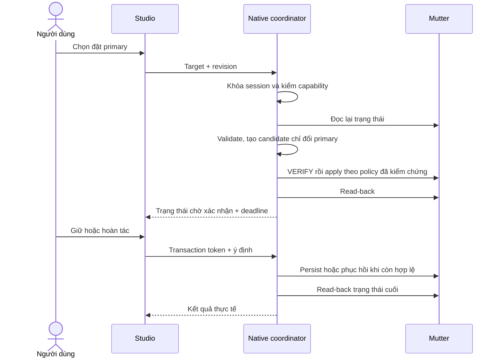

# Phân tích hệ thống: chuyển màn hình chính

Ngày: 31/10/2026. Đầu vào: [kế hoạch chức năng](PRIMARY_MONITOR_PLAN.md). Phạm vi giai đoạn này: phân tích mã nguồn và khảo sát chỉ đọc trên phiên GNOME thực tế; chưa triển khai chức năng, chưa gọi VERIFY/APPLY, chưa thay topology.

## 1. Kết luận khả thi

Có thể triển khai adapter GNOME bằng GIO/D-Bus hiện có trong dự án. Phiên X11 hiện tại công bố GetCurrentState, ApplyMonitorsConfig, MonitorsChanged và ApplyMonitorsConfigAllowed=true. Đây là bằng chứng API và capability đọc được, chưa chứng minh apply thành công, giữ nguyên mọi thuộc tính, persistence hoặc phục hồi sau crash.

Điều kiện trước khi cho người dùng đổi thật: xác minh semantics apply/confirm/persist và cơ chế phục hồi độc lập với UI trong môi trường thử riêng. API tồn tại không đủ để công bố hỗ trợ. Wayland, KDE và COSMIC chưa được khảo sát cho chức năng này.

## 2. Hệ thống hiện tại — AS-IS

| Thành phần đã đọc | Vai trò hiện tại | Khoảng trống |
| --- | --- | --- |
| `src/Studio.tsx` | Các tab Dock, ứng dụng, giao diện, hình nền, hệ thống | Chưa có tab màn hình |
| `src/hooks/usePlatform.ts` | Đọc platform, refresh theo event, gộp request chồng nhau | Monitor chưa có primary, active, logical identity hoặc capability đổi primary |
| `src-tauri/src/platform.rs` | Liệt kê monitor bằng Tauri, capability theo desktop/session | Không quản lý cấu hình màn hình OS |
| `src-tauri/src/layout.rs` | Chọn primary/cụ thể/tất cả, tạo/dọn các Dock | Watcher 2 giây so sánh debug signature danh sách monitor, không đưa primary vào signature một cách tường minh |
| `src-tauri/src/popup.rs` | Popup có nguồn Dock và generation | Cần đóng hoặc vô hiệu hóa anchor khi topology/primary đổi |
| `src-tauri/src/config.rs` | Cấu hình DeskMorph có schema/revision | Revision này không phải serial topology của Mutter |
| `src-tauri/src/instance.rs` | Single-instance theo config directory | Hai profile khác nhau được chạy đồng thời nhưng cùng điều khiển desktop |
| `tests/mutter_scaling_probe.py` | Snapshot, VERIFY/TEMPORARY, restore cho test | Không có giao dịch sản phẩm hoặc chứng nhận persist; không dùng nguyên helper test làm adapter runtime |

Luồng hiện tại: Studio → IPC cấu hình Dock → config store → layout → cửa sổ Tauri. Thay `config.monitor` chỉ đổi Dock; không đổi màn hình chính OS.

Sự cố hai Dock đè nhau trước đây do instance test và instance người dùng cùng chạy. Với tính năng mới, phân tách profile cũng không phân tách tài nguyên màn hình, nên khóa giao dịch chỉ trong `AppHandle` là chưa đủ.

## 3. Khảo sát API thực tế

Khảo sát chỉ đọc bằng session D-Bus, ngày 31/10/2026:

- Desktop GNOME, session X11.
- Service/interface: `org.gnome.Mutter.DisplayConfig`; object `/org/gnome/Mutter/DisplayConfig`.
- `GetCurrentState` trả `(u, a((ssss)a(siiddada{sv})a{sv}), a(iiduba(ssss)a{sv}), a{sv})`: serial, physical monitors/modes, logical monitors, properties.
- `ApplyMonitorsConfig` nhận `(u, u, a(iiduba(ssa{sv})), a{sv})`: serial, method, logical configuration, properties. Read model và write model khác nhau; không thể round-trip nguyên mảng đọc vào apply.
- Có signal `MonitorsChanged`; không mang snapshot, cần đọc lại trạng thái.
- Property `ApplyMonitorsConfigAllowed` có giá trị `true` tại thời điểm khảo sát. Vẫn phải xử lý từ chối ở lúc apply.
- Snapshot tại serial 195: `eDP-1-1` primary tại (0,0), `HDMI-0` secondary tại (1920,0); scale 1, transform 0 trên cả hai.
- Global property keys: renderer, layout-mode, global-scale-required, legacy-ui-scaling-factor, max-screen-size. Snapshot hiện tại không có supports-changing-layout-mode; không tự thêm property ghi từ giả định.

Introspection xác nhận chữ ký API, không mô tả đầy đủ semantics timeout/persist. Harness cũ chỉ cho phép method 0 (VERIFY) và 1 (TEMPORARY). Không suy ra TEMPORARY tự động hoàn tác; semantics method lưu bền và hộp xác nhận cần kiểm chứng bằng tài liệu/source đúng phiên bản và integration riêng.

## 4. Tác nhân và ranh giới

| Tác nhân | Quyền sở hữu/trách nhiệm |
| --- | --- |
| Người dùng | Chọn màn, giữ hoặc hoàn tác thay đổi |
| Studio | Trình bày snapshot và trạng thái giao dịch, gửi ý định |
| Native display coordinator | Validate, serialize, theo dõi deadline, read-back, phát trạng thái |
| Adapter GNOME | Chuyển model sang D-Bus và xử lý lỗi giao thức |
| Mutter / desktop | Nguồn sự thật về cấu hình đang chạy, policy và persistence |
| Settings và client khác | Có thể thay cấu hình cùng lúc, phải được tôn trọng |
| Dock layout/popup | Phản ứng theo snapshot đã quan sát, không sở hữu primary OS |

Không cần root theo đường API session đang khảo sát. Không gọi sudo hoặc sửa trực tiếp monitors.xml. Không nhận payload cấu hình màn hình tùy ý từ frontend; UI gửi target và version, native tự tạo thay đổi có phạm vi giới hạn.

## 5. Yêu cầu chức năng — TO-BE

| ID | Yêu cầu | Kết quả quan sát được |
| --- | --- | --- |
| FR01 | Đọc màn vật lý và nhóm logical đang hoạt động | Nhãn primary đúng; màn tắt không thành target |
| FR02 | Hiển thị capability và lý do không khả dụng | Không có nút hoạt động giả trên desktop chưa hỗ trợ |
| FR03 | Chuyển primary sang logical target hợp lệ | Read-back xác nhận target mới, chỉ một primary khi cấu hình active hợp lệ |
| FR04 | Giữ các thuộc tính khác | Mode ID/refresh, scale, transform, vị trí, output membership và thuộc tính cấu hình đã hỗ trợ giữ nguyên |
| FR05 | Giữ/hoàn tác/hết giờ | Trạng thái cuối được xác nhận; không báo “đã lưu” khi chỉ apply tạm |
| FR06 | Phát hiện topology và thay đổi bên ngoài | Snapshot refresh; transaction cũ không ghi đè thay đổi mới |
| FR07 | Đồng bộ các chế độ Dock | Primary theo màn mới, cụ thể giữ target, tất cả có một Dock mỗi logical monitor |
| FR08 | UI vi/en và bàn phím/screen reader | Nhãn, lỗi, pending, focus và kết quả có thể tiếp cận |
| FR09 | Hỗ trợ single-screen và mirror | Single-screen không có thao tác thừa; mirror thao tác theo nhóm |

Ngoài phạm vi: đổi bố trí/độ phân giải, tự bật output, tự di chuyển mọi cửa sổ, tự đặt primary khi startup/hotplug và áp primary qua import/preset DeskMorph.

## 6. Dữ liệu cần bổ sung

| Model dự kiến | Trường quan trọng | Quy tắc |
| --- | --- | --- |
| DisplayCapabilities | canRead, canSetPrimary, canPersist, recoveryAvailable, reason | Chỉ bật mutation khi adapter và recovery đã kiểm chứng |
| DisplaySnapshot | revision nội bộ, compositor serial, owner/session generation, logical/physical lists | Không dùng config revision; phát hiện service restart và serial tái sử dụng |
| PhysicalMonitor | connector, thông tin hiển thị cần thiết, current mode, supported modes, thuộc tính | Serial thiết bị nếu cần chỉ dùng nội bộ; tránh ghi log dữ liệu nhận diện không cần thiết |
| LogicalMonitor | id trong snapshot, connectors, x/y, scale, transform, primary | Mirror có nhiều connector; không dùng tên hiển thị làm ID |
| PrimaryTransaction | token, baseline, target, applied fingerprint, monotonic deadline, state | Native sở hữu; scope theo display session, không theo profile |
| DisplayError | code, phase, recoverability, observed state | UI dịch mã; chẩn đoán không thay thế thông báo hành động |

ID logical chỉ hợp lệ cùng revision; reconnect làm target cũ hết hiệu lực. Snapshot gốc có đủ dữ liệu phục hồi, nhưng chỉ ghi các property mà API cho phép. Thuộc tính không biết/không thể bảo toàn phải được phân loại; từ chối apply nếu không thể đáp ứng cam kết giữ cấu hình thay vì âm thầm bỏ qua.

## 7. Luồng nghiệp vụ và trạng thái

Máy trạng thái dự kiến: Idle → Validating → Applying → AwaitingConfirmation → Confirming hoặc Reverting → Completed. Lỗi trước apply kết thúc không thay đổi; lỗi sau apply đi vào reconciliation trước khi báo kết quả. Nếu không đọc được trạng thái, trả Unknown/RecoveryFailed và hướng dẫn mở Settings; không báo đã hoàn tác.

Trường hợp đặc biệt:

- Chọn primary hiện tại: no-op, không tạo giao dịch.
- Request thứ hai hoặc profile khác: từ chối busy; khóa native theo user + display session, giải phóng đúng vòng đời giao dịch. Đây là điều phối giữa các instance DeskMorph; client desktop bên ngoài vẫn cần optimistic concurrency và read-back.
- Rút cáp, service restart hoặc Settings ngoài thay đổi: đọc lại, phân biệt sự kiện do mình và bên ngoài bằng fingerprint; signal đơn lẻ không đủ kết luận xung đột.
- Rollback chỉ khi target/baseline còn tương thích và trạng thái hiện tại thuộc giao dịch; dùng serial mới. Có khoảng đua giữa read và apply nên xử lý serial bị từ chối, không retry ghi đè mù.
- Deadline dùng monotonic clock; đóng tab/Studio không hủy nghĩa vụ phục hồi. Crash/SIGKILL yêu cầu compositor hoặc thành phần giám sát độc lập, không dựa vào callback thoát app.
- Persist có thể là apply lần nữa tùy policy; phải kiểm trạng thái hiện tại trước khi lưu, tránh lưu cả thay đổi không thuộc giao dịch.

## 8. Yêu cầu phi chức năng và ảnh hưởng kiến trúc

- D-Bus có timeout hữu hạn, không chặn GTK main thread. Serialize mutation nhưng tránh giữ mutex trong lúc gọi IPC/chờ event; layout cần main context GTK.
- Gộp MonitorsChanged, đọc lại rồi cập nhật layout khi trạng thái ổn định; response cũ không ghi đè snapshot mới.
- Theo dõi đổi primary ngay cả khi mode và tọa độ không đổi. Không phụ thuộc duy nhất vào `Debug` của Tauri Monitor.
- Phân biệt tọa độ logical của Mutter với physical của Tauri; không chuyển trực tiếp giữa hai hệ mà không xét layout mode/scale.
- Không ghi config primary vào DeskMorph JSON; startup chỉ quan sát. Persistence thuộc desktop.
- Quản lý subscribe/unsubscribe, khóa liên tiến trình và watchdog trong startup/shutdown. Test profile phải opt-in mutation, tránh instance thử vô tình điều khiển desktop thật.
- Log phase/error và fingerprint cần thiết; không log toàn environment, serial thiết bị hoặc toàn bộ desktop.
- Chấp nhận độ trễ event/reconcile nhưng dùng deadline xác định; chốt ngân sách thời gian sau đo adapter, không hứa số hiệu năng khi chưa có bằng chứng.

## 9. Phạm vi thay đổi mã dự kiến

| Vùng | Thay đổi cần thiết |
| --- | --- |
| Module mới `src-tauri/src/displays/` | Model, adapter, coordinator, policy, event lifecycle và lỗi |
| `src-tauri/src/lib.rs` | Đăng ký state/commands, startup/shutdown |
| `platform.rs`, `usePlatform.ts` | Capability và primary summary đồng nhất; state chi tiết có API riêng |
| `layout.rs`, `popup.rs` | Primary-aware reconcile và dọn anchor/cửa sổ thừa |
| `Studio.tsx`, panel màn hình mới | Danh sách, chọn target, giao dịch và refresh |
| i18n, ErrorText/capability mapping | Nhãn và lỗi vi/en, accessibility |
| Tests và tài liệu | Fixture, transaction integration, native evidence và support matrix |

Chưa chốt chữ ký IPC, cấu trúc module chi tiết hoặc watchdog implementation ở giai đoạn phân tích. Các tên trong kế hoạch là dự kiến, sẽ được quyết định trong System Design.

## 10. Rủi ro, quyết định và câu hỏi còn mở

| Rủi ro/câu hỏi | Hướng xử lý trước khi triển khai |
| --- | --- |
| TEMPORARY không có auto-revert; persist mở xác nhận desktop riêng | Khảo sát semantics/source đúng phiên bản và chạy trong desktop thử |
| Chết app làm mất timer | Chứng minh phục hồi độc lập; thiếu thì không bật mutation |
| Model đọc/ghi khác nhau, thuộc tính chưa biết | Lập allowlist và invariant preservation theo backend/version |
| Client ngoài hoặc profile khác đổi cùng lúc | Khóa theo session, revision, fingerprint, read-back và conflict handling |
| Primary đổi nhưng monitor signature không đổi | Subscribe DisplayConfig và đưa primary vào topology fingerprint |
| Đổi primary tái tạo extra Dock | Kiểm số Dock và input region, source popup, focus, cleanup |
| Layout mode/DPI khác nhau | Giữ hệ tọa độ nguồn và test mixed DPI riêng |
| API có nhưng compositor từ chối/khác hành vi | Capability runtime + ma trận support thực nghiệm |
| Restart/login làm mất thay đổi | Kiểm persistence ở cấp desktop; không tự áp từ app config |

Các quyết định đã đủ cơ sở: dùng adapter GNOME/GIO, OS là nguồn sự thật, primary và vị trí Dock là hai ý niệm riêng, giao dịch native, khóa xuyên profile và không đưa primary vào preset.

Các quyết định còn cần bằng chứng: policy xác nhận, cơ chế crash recovery, semantics persist, thuộc tính bắt buộc bảo toàn và mức hỗ trợ từng phiên GNOME. Đây là đầu việc kỹ thuật cần khảo sát tiếp, không phải thiếu lựa chọn từ người dùng.

## 11. Truy vết và tiêu chí kết thúc giai đoạn

| Nhóm yêu cầu | Hạng mục kế hoạch | Bằng chứng cần ở giai đoạn sau |
| --- | --- | --- |
| FR01–02 | P1, P2.1, P3.1 | Adapter snapshot/capability và native read |
| FR03–05 | P2.2–P2.6, P3.2–P3.4 | Preservation, transaction, timeout/crash, persistence |
| FR06 | P2.7–P2.8 | Hotplug, external mutation, serial/service restart |
| FR07 | P4 | Ba chế độ Dock, primary đổi không đổi geometry, không trùng Dock |
| FR08–09 | P3.5, P5–P6 | vi/en, keyboard/Orca, single-screen/mirror |

Đã hoàn thành đầu ra phân tích: hiện trạng có tham chiếu mã, xác nhận API chỉ đọc, ranh giới/tác nhân, yêu cầu và dữ liệu, luồng nghiệp vụ, tác động, rủi ro và tiêu chí kiểm chứng. Chưa hoàn thành toàn bộ P1 của kế hoạch: VERIFY/apply, persistence và recovery chưa được thử ở bước này. Bước tiếp theo là System Design, đồng thời làm spike trong môi trường riêng để chốt các điểm còn mở trước khi xây mutation production.

Tài liệu đầu ra giai đoạn kế tiếp: [Thiết kế hệ thống v1](PRIMARY_MONITOR_SYSTEM_DESIGN.md). Các khảo sát mutation/persistence/recovery vẫn là điều kiện kiểm chứng trước khi bật chức năng.
