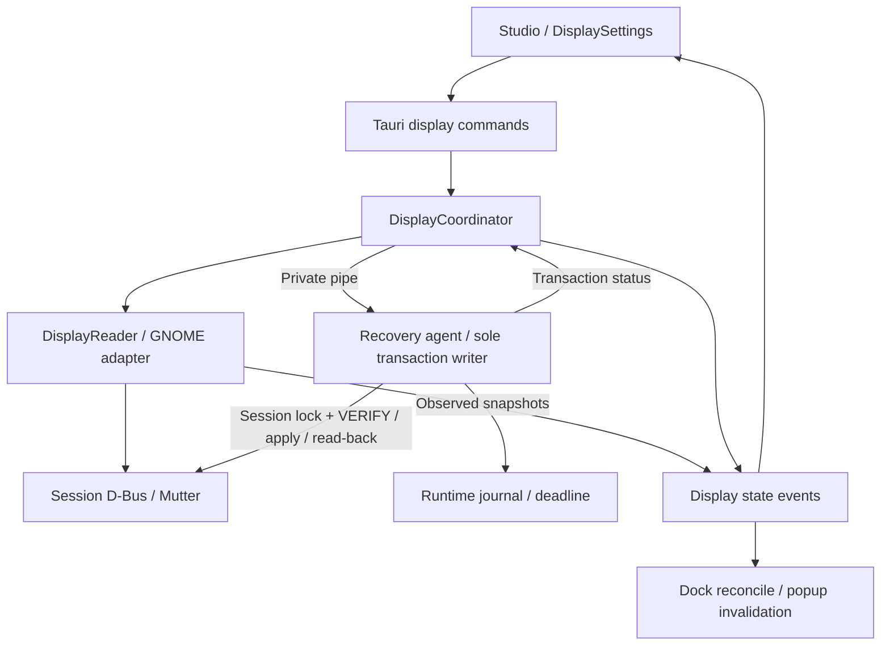
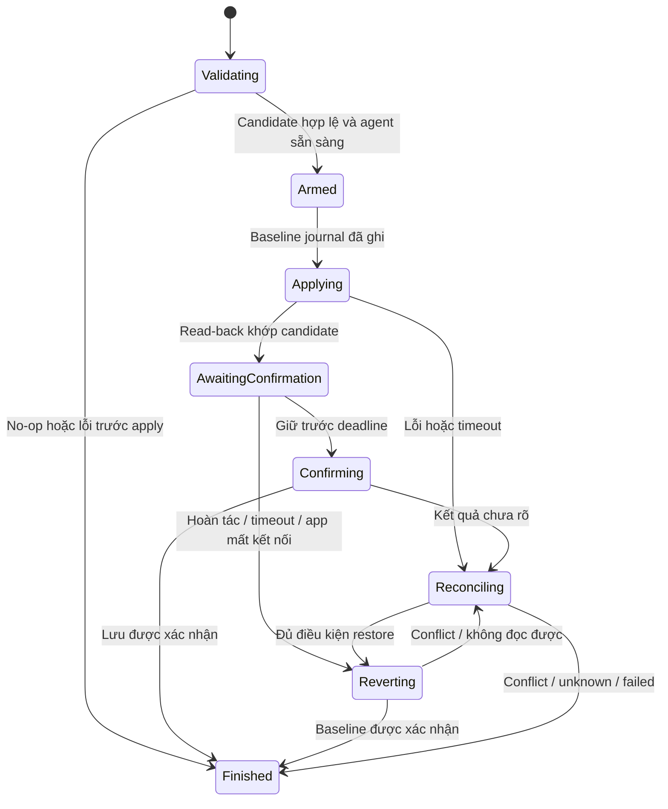

# Thiết kế hệ thống: chuyển màn hình chính

Ngày: 31/10/2026. Trạng thái: đặc tả thiết kế v1, chưa triển khai. Đầu vào: [System Analysis](PRIMARY_MONITOR_SYSTEM_ANALYSIS.md), [kế hoạch](PRIMARY_MONITOR_PLAN.md).

## 1. Các quyết định thiết kế

| ID | Quyết định | Lý do |
| --- | --- | --- |
| D01 | Adapter đầu tiên là GNOME DisplayConfig, dùng GIO hiện có | Đã quan sát được API, không thêm shell/xrandr vào luồng sản phẩm |
| D02 | OS là nguồn sự thật; không lưu primary trong config DeskMorph | Startup, import và preset không được tự đổi desktop |
| D03 | Đọc trạng thái tách khỏi mutation; capability theo từng policy được chứng nhận | Có GetCurrentState không đồng nghĩa được bật nút đổi |
| D04 | Coordinator native điều phối; recovery agent riêng là writer duy nhất trong giao dịch | Giữ quyền phục hồi khi UI hoặc tiến trình ứng dụng chết |
| D05 | Khóa giao dịch theo session D-Bus/display service, xuyên config profile | Hai instance không được tranh nhau điều khiển cùng desktop |
| D06 | Snapshot có revision và owner generation; mọi lần ghi dùng trạng thái/serial mới | Chống selection cũ, service restart và thay đổi bên ngoài |
| D07 | Candidate chỉ đổi primary, adapter kiểm invariant thuộc tính | Không tái cấu hình màn ngoài phạm vi |
| D08 | Tối đa một nơi xác nhận: compositor hoặc Studio tùy policy đã kiểm chứng | Không có hai countdown cạnh tranh |
| D09 | Event display riêng kích hoạt Dock reconcile, có fingerprint primary tường minh | Đổi primary có thể không đổi tọa độ/mode |
| D10 | Chưa qua bài thử phục hồi/persist thì chỉ đọc và mở Settings | Không suy hỗ trợ từ chữ ký D-Bus |

D04 là lựa chọn kiến trúc, không phải bằng chứng agent đã tồn tại. Có thể bỏ agent ở adapter tương lai chỉ sau khi chứng minh compositor bảo đảm toàn bộ phục hồi cần thiết; thay đổi đó cần cập nhật thiết kế và test crash.

## 2. Kiến trúc thành phần



UI không truyền layout, mode hoặc shell command. Agent chỉ nhận baseline/target đã validate qua kênh native riêng và tự đọc lại trước khi ghi. Reader của ứng dụng được đọc song song, nhưng không kết luận trạng thái transaction thay agent. Các thao tác GTK/layout chỉ chạy trên main context; D-Bus và agent I/O chạy ngoài GTK thread.

### Phân chia module dự kiến

```text
src-tauri/src/displays/
  mod.rs           # state, command façade, startup/shutdown
  model.rs         # DTO công khai và model nội bộ
  adapter.rs       # trait, capability, preservation contract
  gnome.rs         # GIO DisplayConfig read/write mapping
  coordinator.rs   # command serialization, UI ownership, events
  transaction.rs   # state machine thuần và quyết định recovery
  agent.rs         # entrypoint, private protocol, sole writer
  session_lock.rs  # khóa xuyên profile
  journal.rs       # runtime journal, validation và cleanup
src/components/studio/DisplaySettings.tsx
src/hooks/useDisplays.ts
src/displays/types.ts
```

Không tách executable/package thứ hai ở bản đầu: recovery agent là chế độ nội bộ `--display-agent` của chính executable. Parse chế độ này trước startup Tauri và single-instance forwarding; không tạo cửa sổ, socket Studio hoặc đăng ký autostart. Chạy executable bằng đường tuyệt đối từ native, không qua shell. CLI này không phải API điều khiển cho người dùng.

## 3. Dữ liệu và hợp đồng adapter

### DTO frontend

```ts
type DisplayState = {
  revision: string;             // opaque, đổi khi observed topology/owner đổi
  sequence: number;             // thứ tự publication trong process epoch
  epoch: string;                // process epoch, tránh so số qua restart
  capabilities: {
    canRead: boolean;
    canSetPrimary: boolean;
    canPersist: boolean;
    recoveryAvailable: boolean;
    confirmationOwner: 'studio' | 'compositor' | 'unavailable';
    reason: string | null;
  };
  logicalMonitors: {
    id: string;                 // chỉ hợp lệ cùng revision
    name: string;
    connectors: string[];
    primary: boolean;
    x: number; y: number;       // logical units theo adapter
    scale: number;
    transform: number;
  }[];
  physicalMonitors: {
    connector: string;
    name: string;
    active: boolean;
    logicalId: string | null;
    width: number | null;
    height: number | null;
    refreshHz: number | null;
  }[];
  transaction: TransactionView | null;
};
type TransactionView = {
  id: string;
  phase: 'validating' | 'applying' | 'awaitingConfirmation'
    | 'confirming' | 'reverting' | 'reconciling' | 'finished';
  targetId: string;
  confirmationOwner: 'studio' | 'compositor';
  remainingMs: number | null;
  outcome: null | 'unchanged' | 'kept' | 'reverted' | 'conflict'
    | 'failed' | 'unknown';
  persistence: 'notRequested' | 'pending' | 'confirmed' | 'unknown';
};
```

`kept` chỉ có nghĩa toàn bộ policy giữ/lưu đã được xác nhận. Primary active đúng nhưng trạng thái lưu chưa biết thì outcome không được là kept với persistence confirmed. Không gửi serial thiết bị, baseline phục hồi hoặc compositor serial cho UI.

### Model nội bộ

- `SessionIdentity`: UID, session bus GUID và unique owner của DisplayConfig; khóa tài nguyên dựa UID + bus GUID + tên service ổn định, **không** dựa unique owner để service restart không mở khóa thứ hai.
- `NativeSnapshot`: owner generation, serial, read DTO, active mode IDs, physical properties, logical groups và layout mode. Giữ giá trị nguồn chính xác, không round mode/refresh khi dựng candidate.
- `TopologyFingerprint`: canonical theo connector/group, mode ID, thuộc tính đã phân loại, vị trí, scale, transform và primary; bỏ serial/order danh sách. So sánh nội bộ, không dùng `Debug` hoặc hash làm bằng chứng độc lập; đối chiếu cấu trúc khi quyết định ghi/rollback.
- `PrimaryTransaction`: baseline, candidate, current expected state, request ID, transaction token, confirmation policy, deadline và terminal result.
- `AdapterPolicy`: supported version/capabilities, writable properties allowlist, confirmation mechanism, persistence verifier và recovery constraints.

### Adapter operations

`probe`, `read`, `build_primary_candidate`, `verify`, `apply_preview`, `request_keep`, `observe_confirmation`, `restore`, `observe_persistence`.

Operations trả typed error và trạng thái observed; không mặc định `request_keep` thành công là đã lưu. Trait cho phép policy compositor quản lý confirm, nhưng không giả định GNOME có phương thức confirm riêng chỉ vì ApplyMonitorsConfig tồn tại.

Invariant: tập output active/mirror, mode ID và refresh, vị trí, scale, transform, layout mode và các property ảnh hưởng cấu hình không thay đổi; chỉ cờ primary được đổi. Metadata read-only được bỏ qua theo danh mục có tài liệu. Writable property chưa phân loại làm capability mutation unavailable cho snapshot đó. Không blindly copy `a{sv}` read-only vào payload ghi.

## 4. Hợp đồng IPC và event

| Command | Input | Output / quy tắc |
| --- | --- | --- |
| `get_display_state` | Không | DisplayState hiện tại; refresh được gộp |
| `preview_primary_monitor` | targetId, expectedRevision, requestId | DisplayState có transaction hoặc unchanged; cùng requestId không được apply hai lần |
| `confirm_primary_monitor` | transactionId | Chỉ chủ giao dịch, khi Studio sở hữu confirm và chưa hết hạn |
| `revert_primary_monitor` | transactionId | Cùng quyền như confirm; idempotent ở trạng thái kết thúc |
| `open_display_settings` | Không | Mở desktop entry Settings phù hợp bằng GIO; không tự đổi cấu hình |

Mutation chỉ chấp nhận caller WebviewWindow label `main`, lấy từ Tauri injection; không tin label/sourceDock do JavaScript gửi. Global event chỉ mang snapshot đã lược dữ liệu; token điều khiển không broadcast cho Dock. Transaction ID ở event là ID hiển thị; quyền điều khiển gắn native owner với IPC session của Studio. Nếu cần secret cho kênh agent, nó không được đi qua frontend.

Event `deskmorph:display-state` có envelope `{epoch, sequence, state}`. Hook subscribe trước khi lấy snapshot; chỉ nhận sequence mới cùng epoch, khi epoch thay đọc lại. Response trễ không ghi đè event mới. Native cache requestId có giới hạn 32 kết quả, tối đa 5 phút; mất kết nối command thì UI đọc lại transaction thay vì tạo request ID mới để retry mutation.

Ứng dụng không sở hữu giao dịch agent của instance khác: UI hiển thị busy và trạng thái OS đọc được; không cấp quyền xác nhận giao dịch đó. Sau restart ứng dụng, agent còn sống giữ quyền phục hồi, không tự nhận confirm từ process mới.

### Lỗi

`display_unsupported`, `display_read_failed`, `display_permission_denied`, `display_busy`, `display_stale_revision`, `display_target_missing`, `display_preservation_unsupported`, `display_verify_failed`, `display_apply_failed`, `display_timeout`, `display_transaction_expired`, `display_conflict`, `display_persist_unverified`, `display_recovery_failed`, `display_state_unknown`.

Payload lỗi `{code, message, context: {phase, transactionId?, recoveryAttempted, stateKnown}}`, tương thích normalizer hiện có. Raw D-Bus diagnostics chỉ ở phần chi tiết. Không đưa baseline vào error.

## 5. Giao dịch, deadline và concurrency



1. Coordinator validate caller, request ID, revision và target; kiểm capability mới nhất.
2. Spawn agent bằng private inherited pipe. Agent giữ `flock` không chờ lâu trên file khóa session, rồi tự đọc baseline và kiểm lại revision/owner. File khóa không bị xóa sau unlock để tránh hai inode khóa khác nhau.
3. Dựng candidate, VERIFY với serial hiện hành. Ghi journal, arm recovery và gửi READY; chưa READY thì không apply.
4. Agent apply preview, đọc lại và so invariant. App nhận trạng thái để cập nhật UI. Nếu D-Bus timeout sau gửi apply, xem kết quả là chưa biết và reconcile; không gửi lại apply mù.
5. Khoảng chờ xác nhận Studio mặc định thiết kế 20 giây sau read-back đạt. Dùng Linux CLOCK_BOOTTIME để thời gian suspend được tính; sau resume hết hạn thì lập tức reconcile/restore khi hợp lệ. Deadline phải khởi tạo bảo vệ từ trước apply, không chỉ sau khi UI nhận event.
6. Agent xử lý tuần tự confirm/revert/timer. Giữ chỉ hợp lệ nếu agent nhận trước deadline; khi cùng thời điểm hoặc sau deadline, revert thắng. Countdown UI chỉ minh họa, không có quyền kéo dài deadline.
7. Trước persist hoặc restore đọc lại owner, serial và cấu trúc state. Candidate/current khác do bên ngoài thì kết thúc conflict và không ghi đè. Snapshot còn là candidate của mình thì thực hiện theo policy với serial mới.
8. Kết thúc chỉ khi read-back và persistence/recovery verifier tương ứng đủ bằng chứng. Giữ kết quả terminal để trả retry, giải phóng lock và xóa journal chỉ sau khi ghi kết quả cuối.

Không giữ mutex coordinator khi gọi D-Bus, pipe hoặc GTK. Khóa session bao trùm verify → preview → confirm/restore/reconcile, do agent giữ nên crash ứng dụng không giải phóng sớm. Khóa này không ngăn GNOME Settings: serial/fingerprint/read-back vẫn bắt buộc. Không thể phân biệt tuyệt đối một client ngoài ghi lại cấu hình giống hệt candidate; thiết kế chỉ phát hiện xung đột quan sát được, không tuyên bố quyền sở hữu toàn cục của desktop.

Giới hạn ban đầu để kiểm chứng: D-Bus call 5 giây, agent handshake 3 giây, reconcile tối đa 3 read với backoff 200/500 ms, tổng recovery attempt 15 giây. Đây là ngân sách thiết kế, sẽ đo và điều chỉnh; không chặn vô hạn vì chờ service đã chết. Sau unknown/recovery failure, khóa mutation của process ứng dụng cho tới refresh/chẩn đoán xác nhận trạng thái. Nếu session vẫn còn nhưng service tạm mất, journal được giữ cho quy trình recovery có điều kiện, không retry apply không giới hạn.

## 6. Phục hồi độc lập và policy xác nhận GNOME

### Agent và journal

- Agent không nằm trong process group bị ứng dụng dọn tự động; app chỉ giữ pipe. EOF hoặc lệnh hủy trước keep kích hoạt recovery, không kill agent trong cleanup của Tauri.
- Dữ liệu truyền theo protocol version + frame length, giới hạn 256 KiB; nonce sinh từ OS qua native, kiểm UID/session/baseline và không nhận payload qua socket công khai. Giới hạn snapshot vượt mức thì từ chối mutation.
- Runtime directory thuộc UID, mode 0700; journal mode 0600, tạo chống symlink, ghi atomic + fsync trước apply. Chứa schema, session/service generation, baseline/candidate và deadline; không chứa khóa/token điều khiển Studio.
- Nếu agent chết, app chuyển unknown, khóa mutation và khởi động recovery agent thay thế sau khi lấy được cùng lock; agent thay thế đọc journal và tự validate. Nếu cả app và agent cùng chết thì không bảo đảm tự restore tức thời. Journal chỉ hỗ trợ recovery khi process khởi động lại cùng session và trạng thái còn đủ điều kiện; ghi rõ giới hạn này khi công bố hỗ trợ.
- Session/logout mất đi: journal của runtime session không dùng để restore ở phiên mới. Không hứa phục hồi qua reboot hoặc override cấu hình compositor của phiên khác.

### Hai policy có cùng contract, chỉ bật policy đã chứng minh

| Policy | Nơi xác nhận | Điều kiện kích hoạt |
| --- | --- | --- |
| Studio-managed | Studio “Giữ / Hoàn tác”; agent thực hiện persist sau keep | GNOME backend đã chứng minh preview, persist không mở xác nhận thứ hai và persistence verifier đáng tin |
| Compositor-managed | Hộp xác nhận desktop; Studio chỉ hiển thị đang chờ | Backend chứng minh desktop timeout/revert và có tín hiệu/kết quả phân biệt giữ với hoàn tác, gồm persistence |

Policy được chốt theo kết quả spike đúng GNOME/version/backend, không cho người dùng chọn tùy ý. Chưa có bằng chứng cho policy nào thì `canSetPrimary=false`, reason `display_recovery_unverified`. Agent không tự bấm hộp xác nhận GNOME, không tự sửa monitors.xml, không giả định method TEMPORARY có timer. Semantics method persist cần đối chiếu source/tài liệu đúng phiên bản trước khi mapping vào adapter.

Trường hợp compositor đang chờ xác nhận mà app mất kết nối: agent ưu tiên cơ chế cancel/revert đã chứng nhận của policy; không apply song song làm rối giao dịch desktop. Spike phải chứng minh tình huống này trước khi bật policy.

## 7. Đồng bộ Dock và topology

DisplayReader subscribe MonitorsChanged và NameOwnerChanged; debounce 150 ms, tối đa trì hoãn 1 giây khi sự kiện dồn. Nếu có transaction, chuyển thông báo cho agent để read/reconcile; không tự coi mọi signal là conflict. Reader theo dõi lifecycle và unsubscribe khi thoát.

Sau snapshot được xác nhận:

1. Invalidate popup/tooltip anchor trên main GTK context.
2. Chờ nguồn monitor Tauri/GDK đồng bộ với snapshot. Match connector/nhóm theo mapping adapter đã kiểm; không dùng thứ tự danh sách. Retry có giới hạn tối đa 2 giây rồi báo reconcile chưa xong và tiếp tục quan sát, không tạo theo dữ liệu trộn cũ/mới.
3. Dock primary theo primary mới; Dock cụ thể giữ connector đã chọn; tất cả tạo một Dock cho mỗi logical monitor đang active.
4. Lập desired window set rồi reconcile; hủy Dock obsolete trước khi show Dock thay thế để tránh chồng. Giữ primary label `taskbar`, extra labels theo group identity; kiểm state per-Dock và generation của callback resize cũ.
5. Chỉ gửi platform-changed sau publication; watcher polling hiện tại giữ làm fallback có fingerprint primary tường minh, không phải nguồn xác nhận transaction.

Nếu mapping logical ↔ GDK không đủ chắc chắn (đặc biệt mirror), không đoán scale/tọa độ. Giữ layout quan sát gần nhất trong lúc reconcile, báo trạng thái và vô hiệu thao tác mới cho tới khi resolve. Hỗ trợ quản lý primary trên Wayland không đồng nghĩa Dock Wayland đã hỗ trợ; hai capability độc lập.

## 8. Thiết kế giao diện

Studio thêm tab “Màn hình / Displays”, không gắn với trạng thái Dock enabled. Các hàng có tên/connector, mode/Hz/scale, nhãn chính/phụ hoặc đang tắt; mirror hiển thị nhóm. Single-screen có giải thích và không có nút đổi thừa.

```text
Màn hình
  Màn hình laptop · eDP-1-1      Màn hình chính
  1920 × 1080 · 100%             [Đang là màn hình chính]

  Màn hình ngoài · HDMI-0        Màn hình phụ
  1920 × 1080 · 100%             [Đặt làm màn hình chính]

  Thay đổi màn hình chính của desktop, giữ nguyên bố trí.
  [Tải lại]  [Mở cài đặt màn hình hệ thống]
```

Sau preview với Studio-managed: một dialog có deadline native, nút “Hoàn tác” và “Giữ thay đổi”. Focus mặc định Hoàn tác; Escape gửi revert, không chỉ đóng dialog. Focus trap trong dialog, trả focus về target nếu còn tồn tại. Chuyển tab không che giao dịch; dialog nằm ở cấp Studio, không trong panel bị unmount. Đóng Studio gửi cancel/revert tốt nhất có thể; agent vẫn giữ deadline khi đóng/thoát/crash.

Compositor-managed: Studio hiển thị hướng dẫn xác nhận ở desktop, không dựng dialog/countdown xác nhận riêng. Có thể hiển thị trạng thái chờ và nút mở Settings khi không quan sát được kết quả.

Thông báo screen reader khi bắt đầu, còn 10/5 giây và kết thúc; không đọc mỗi giây. UI chỉ đổi nhãn primary theo snapshot OS. Lỗi có action phù hợp: refresh khi stale, chờ khi busy, mở Settings khi unsupported/unknown, thử lại sau khi giao dịch đã terminal; không cung cấp retry apply trong khi kết quả cũ chưa rõ.

## 9. Bảo mật và vòng đời

- Native kiểm caller `main` trên mutation; không mở quyền command điều khiển cho mọi Dock chỉ vì capability event wildcard hiện có.
- Không cần root và không yêu cầu người dùng cấp quyền hệ thống mới; backend permission denied trả lỗi.
- Khóa/runtime files không theo config directory; biến môi trường profile thử không cách ly desktop. Test agent phải chỉ tới private bus/compositor bằng cấu hình lab được kiểm trước khi cho mutation.
- GIO observer có subscription ID và worker stop/join hữu hạn. Shutdown ngừng reader và gửi cancel cho agent; không xóa journal hay đóng khóa của agent từ process app.
- Không ghi primary vào config store và không thêm migration. API mới không làm thay đổi cấu hình Dock khi người dùng chỉ mở tab.

## 10. Chiến lược kiểm chứng theo thiết kế

| Tầng | Ca bắt buộc |
| --- | --- |
| Model/preservation | Candidate chỉ khác primary, mirror, property chưa biết, mode ID/refresh không làm tròn |
| State machine | No-op, deadline race, request lặp, command timeout sau apply, persist unknown, rollback conflict |
| Adapter private D-Bus | Serial cũ, owner restart, access denied, signal reorder, timeout, payload read/write khác nhau |
| Agent integration | Hai profile tranh lock, app SIGKILL, agent chết, journal lỗi/symlink, pipe EOF, recovery sau resume |
| UI | vi/en, subscribe/read race, event trễ, dialog không mất khi đổi tab, focus/Escape, Orca |
| Dock integration | Primary đổi geometry giữ nguyên, 3 chế độ Dock, trên/dưới, popup và input region, không đếm nhầm instance |
| GNOME lab | Policy preview/keep/revert, compositor dialog, crash, persistence qua login, không đổi thuộc tính khác |
| Phần cứng thực | A→B→A ba vòng, HDMI hotplug, mixed DPI, mirror/3 màn khi có, phục hồi baseline |

Không dùng read-back primary active để thay bài kiểm persistence; persistence cần observation backend được chứng minh và bài thử qua phiên đăng nhập. Chỉ công bố ma trận đã kiểm, các ca thiếu thiết bị để mở.

## 11. Trình tự triển khai sau thiết kế

1. **Spike GNOME trong lab riêng:** xác minh method semantics, confirmation owner, preservation, persist observation và crash recovery. Đầu ra là AdapterPolicy và bằng chứng; fail thì hoàn thành UI chỉ đọc + mở Settings.
2. **Read path:** model/adapter, event lifecycle, snapshot ordering, tab màn hình và capability.
3. **Transaction core + agent:** pure state machine, session lock, journal/private pipe, fake adapter; chạy fault injection trước khi bật native mutation.
4. **Mutation GNOME:** command façade, policy đã được chứng nhận, timeout/conflict/reconciliation và caller checks.
5. **Dock + accessibility:** desired-set reconcile, source popup, dialog vi/en và focus.
6. **Native acceptance:** chạy ma trận, lưu bằng chứng, cập nhật support docs và build. Không thay đổi màn hình host trong giai đoạn thiết kế.

Điều kiện chuyển từ thiết kế sang triển khai: contract và invariant ở tài liệu này được dùng làm chuẩn; các hằng số timeout có test; policy GNOME chỉ được bật sau spike. Thiết kế không coi các điểm semantics chưa thử là đã xác minh. Không đánh dấu P1–P6 hoàn thành chỉ vì đã có tài liệu.

## 12. Truy vết quyết định

| Yêu cầu phân tích | Phần thiết kế | Bằng chứng đầu ra triển khai |
| --- | --- | --- |
| FR01–02, FR09 | DTO, read adapter, capability, panel | Snapshot/unit + native read, mirror/single-screen |
| FR03–04 | Candidate/invariant, serial/owner validation | Preservation + VERIFY/apply lab |
| FR05 | Agent, journal, state machine, policy confirm | Timeout/crash/revert/persistence integration |
| FR06 | Session lock, events, fingerprint và reconcile | External Settings/hotplug/service restart |
| FR07 | Dock desired-set reconcile | Không trùng/input region đúng trên từng màn |
| FR08 | IPC lỗi, dialog, vi/en và screen reader | Keyboard/Orca native và UI tests |

Ước lượng 4–7 ngày trong kế hoạch ban đầu cần đánh giá lại sau spike, vì agent phục hồi, khóa liên tiến trình và kiểm persistence bổ sung công sức đáng kể. Chưa đưa ra cam kết thời gian triển khai mới khi chưa chốt policy GNOME.
